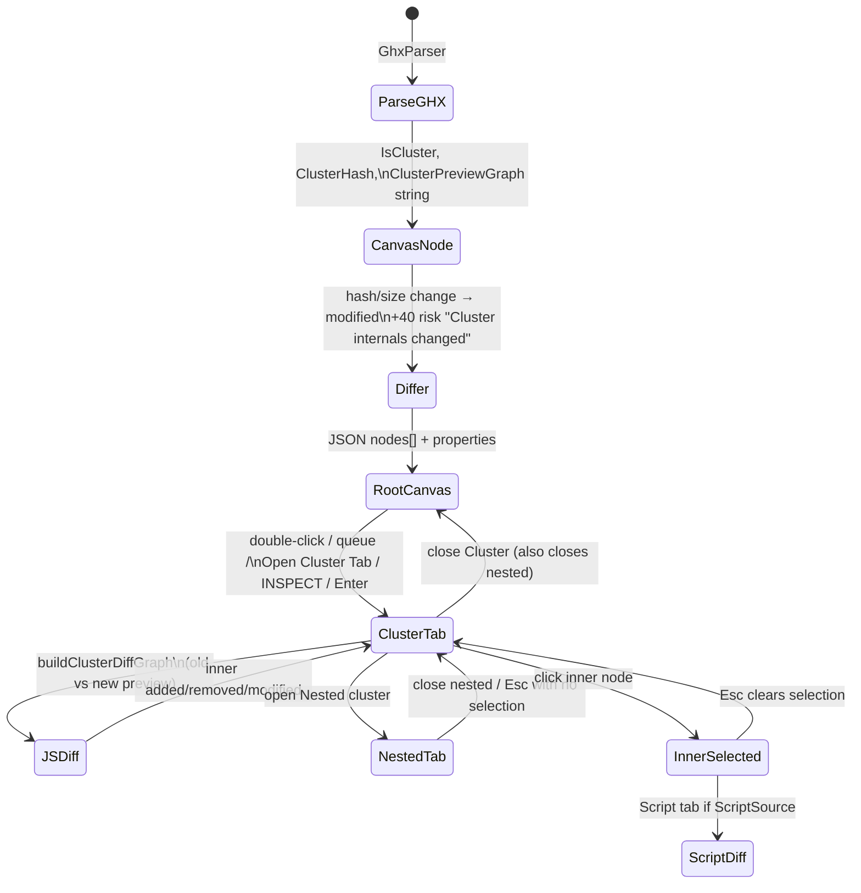

# Cluster interaction

How Grasshopper clusters move from the diff engine to the web UI, and how the viewer behaves once a cluster tab is open.

**Fixture used for UI evidence:** `Tests/data/cluster-interaction/mock_cluster_diff.json`, loaded the same way as `mock_diff_ghx` (inject `window.HOP_DATA` into `diff_viewer.html`). Viewport **1440×900**, DPR 1, console empty. Screenshots: `cluster_1440_root.png`, `cluster_1440_tab.png`, `cluster_1440_inner_selected.png`.

The older `mock_diff_ghx` Cluster node still has `clusterPreviewStatus: 'unavailable'` and no inner graph. That mock never exercised internals.



## Engine → JSON

| Step | What happens |
|------|----------------|
| Parse | `ClusterDocument` Base64 → `IsCluster`, SHA-256 `ClusterHash`, `ClusterSize`. `AttachClusterPreview` re-parses inner XML (depth ≤ 3, ≤ 4000 nodes) into `ClusterPreviewGraph` JSON **string** on the cluster **canvas** node. Nested clusters are parsed recursively. |
| Preview payload | `{ Nodes, Edges, Truncated, Depth }`. Inner cluster nodes keep `IsCluster`, `ClusterHash`, and (after the fix below) their own `ClusterPreviewGraph`. Ordinary inner nodes do not carry preview metadata. |
| Differ | Top-level graph only. Internals are **not** expanded into `DiffComputation.Nodes`. A hash change marks the canvas cluster `modified`, copies old hash/size/preview into `propertiesOld`, and adds **+40** risk `"Cluster internals changed"`. |
| Web JSON | `nodes[].properties.ClusterPreviewGraph` is a **string**. The browser `JSON.parse`s it. Inner added/removed/modified is computed in JS (`buildClusterDiffGraph`). |

## Interaction table

Status is **Works / Broken / Untested** from this run unless noted. Evidence is the 1440 fixture pass.

| Path | Status | Evidence |
|------|--------|----------|
| Inner added / removed / modified | **Works** | Cluster tab queue: Area ADDED, Note REMOVED, Inner C# / Count / Nested MODIFIED. Footer `6 / +1 / −1 / ~3 / same 1`. |
| Nested cluster internals | **Works** (UI fixture) | Nested tab `Main / Cluster / Nested`. Queue: Gone REMOVED, Hello ADDED, Seed MODIFIED. Footer `3 / 1 / 1 / 1 / 0`. Nested inspector showed hash change + **Open Cluster Tab**. |
| Nested preview on inner cluster (engine) | **Works in code, test unrun here** | `GhxParser.BuildClusterPreviewProperties` now keeps `ClusterPreviewGraph` on nested cluster nodes. Unit test `Parse_NestedClusterPreviewGraph_IsPreservedOnInnerClusterNode` added; this environment had no `dotnet`. |
| Cluster whose only change is internal | **Works** | Root Cluster has no boundary `valueChanged`. Status `modified`, tag `CLUSTER · MODIFIED`, reason `Cluster internals changed`, risk 82. |
| Root canvas status / tag / risk | **Works** | Tag glyph+word. Queue `Cluster MODIFIED · Cluster internals changed 82`. Internals roll up via hash, not a walk of inner statuses. |
| Internal high-risk node | **Works as designed** | Inner C# risk **91** on the cluster tab (copied from preview JSON). Alarm band stays on **root** Cluster 82 — engine does not score inner nodes. |
| Double-click canvas | **Works** | After dblclick, tabs `Main` + `Main / Cluster` (active). |
| Queue click | **Works** | Clicking Cluster on Main opened `graph-cluster-3`. Clicking Nested inside Cluster opened `Main / Cluster / Nested`. |
| INSPECT (alarm band) | **Works** | Band target Cluster. Inspect opened `Main / Cluster` while Util tab stayed open. **VIEW SCRIPT DIFF** hidden (`display:none`) because Cluster is not a script. |
| Open Cluster Tab (inspector) | **Works** | Nested node inspector included the button; queue/open path used the same `openClusterGraphTab`. |
| Keyboard Enter | **Works in code; not isolated** | Window `Enter` calls `tryOpenClusterGraphTab`. This run opened via double-click first, so Enter was not measured alone. Queue Enter uses the same helper. |
| Graph tabs: open / switch / close / reopen / two clusters / nested | **Works** | Switch Cluster ↔ Nested ↔ Main. Close X on Cluster returned to Main (and dropped nested children). Reopen via queue created a new Cluster tab. Two tabs: `Main / Cluster` + `Main / Util`. |
| Queue contents per tab | **Works** | Root: 6 changes (Cluster, C#, Point Count, Util, Area, Geo). Cluster: 5 inner changes. Util: Relay ADDED (`same` Util Count hidden). Nested: 3. |
| Footer counts per tab | **Works** | Root `11/1/1/4/5`. Cluster `6/1/1/3/1`. Nested `3/1/1/1/0`. Updated on `switchGraphTab`. |
| Selection | **Works** | Inner C# row `selected`; canvas Ultramarine border; inspector `MODIFIED`. |
| Search | **Works** | On Util tab, spotlight query `Relay` → item `Relay added Relay`. Catalog is the **active tab**. |
| Inspector + script diff inside cluster | **Works** | Inner C# inspector: property + script block changed. Script pane: `using System;` / `public class Script { }` vs `{ int a; }`. |
| Tags per tab | **Works** | Cluster tab tags: INNER C# · MODIFIED, AREA · ADDED, COUNT · MODIFIED, NESTED · MODIFIED, NOTE · REMOVED (glyph+word). |
| Wires per tab | **Works** | Solid Count→Inner C#→Nested; dashed removed Note→XY; added Area wires. Variant C unchanged. |
| Fit / zoom / pan per tab | **Works** | Each tab stores `view`. After pan, Main, then back, tag translates matched (same five matrices; order differed so a naive stringify compare was false). Reopen still **fits** (clears saved view). |
| Alarm band (root) when high-risk is inside a cluster | **Works as designed** | Band computed from root tab only, settled once. Shows Cluster RISK 82, reason Cluster internals changed. Stays visible on cluster tab. Inspect drills into the cluster; it does not retarget Inner C# 91. |
| Old/Both/New + removed inside cluster | **Works** | Mix=Old: Area (added) tag gone; Note (removed) tag remains. Inner `dx`/`dy` now come from old vs new preview positions. |
| Esc | **Works** | Esc with a selection clears it (then a second Esc). Esc with no selection closes the active cluster tab; closing Cluster also closes Nested children and returns to Main. |

## What was broken and what changed

| Broken | Fix |
|--------|-----|
| Nested cluster tabs had no graph: parser stripped `ClusterPreviewGraph` from every inner node | Keep preview graph/status/message on inner nodes that `IsCluster` |
| Footer counts stuck on root after opening a cluster | `updateStats()` in `switchGraphTab` |
| Queue / Enter / alarm **Inspect** only zoomed the cluster box | `tryOpenClusterGraphTab` from queue click/Enter, window Enter, and Inspect |
| Esc did not leave a cluster tab | Esc: dismiss toast → clear selection → close active non-root tab |
| Inner nodes lost nickname, `dx`/`dy`, `riskScore` | `buildClusterDiffGraph` copies them; `dx`/`dy` from old vs new position |
| Alarm **View script diff** stayed on screen for Cluster (`.btn{display:inline-flex}` beat `[hidden]`) | `#btn-band-diff[hidden]{display:none!important}`; skip cluster metadata in script detection |
| No fixture with inner added/removed/modified, wires, nested cluster, inner high-risk | `Tests/data/cluster-interaction/` |

## Still open

- **No `dotnet` in this environment**, so `Parse_NestedClusterPreviewGraph_IsPreservedOnInnerClusterNode` was not executed here.
- **Synthetic `.ghx` pair** (`cluster-old.ghx` / `cluster-new.ghx`) is UTF-8 XML in Base64 so the parser can decode without `GH_IO`. Real Grasshopper binary `ClusterDocument` streams still need `GH_IO.dll`.
- **Inner risk** is not computed by `Differ`. Inner C# 91 is fixture data. Nested shows risk 0.
- **Parent rollup** is hash/size on the canvas cluster, not a recursive status walk (still the P0 “deep cluster diff” gap in `docs/AGENTS.md`).
- **Window Enter** was not measured with double-click disabled.
- **`mock_diff_ghx`** Cluster internals remain empty; use this fixture to exercise clusters.

## How to load the fixture

```bash
python3 Tests/data/cluster-interaction/build_fixture.py \
  --html-out /tmp/mock_cluster_diff.html
# Serve Source/HopTracer.Web/wwwroot and map /diff_viewer.html to that HTML
# (same injection as mock_diff_ghx: window.HOP_DATA).
```
